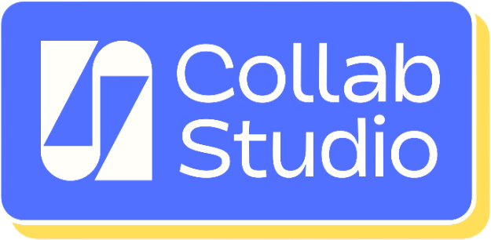
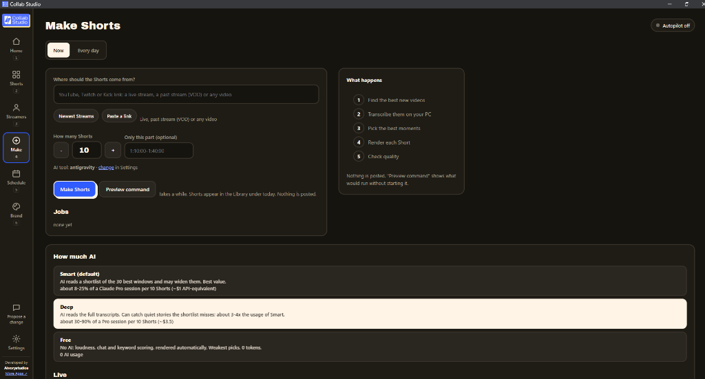
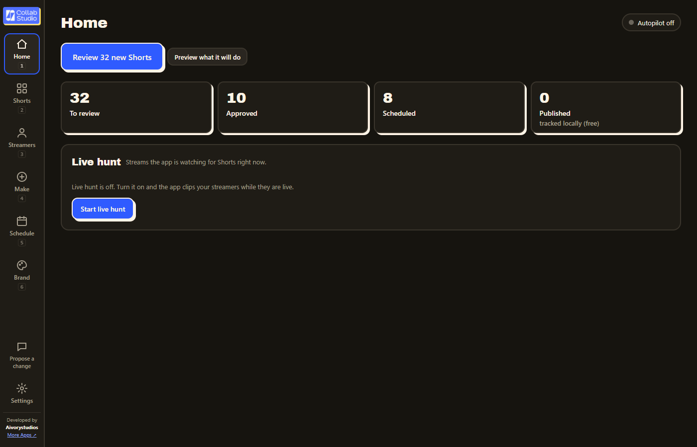
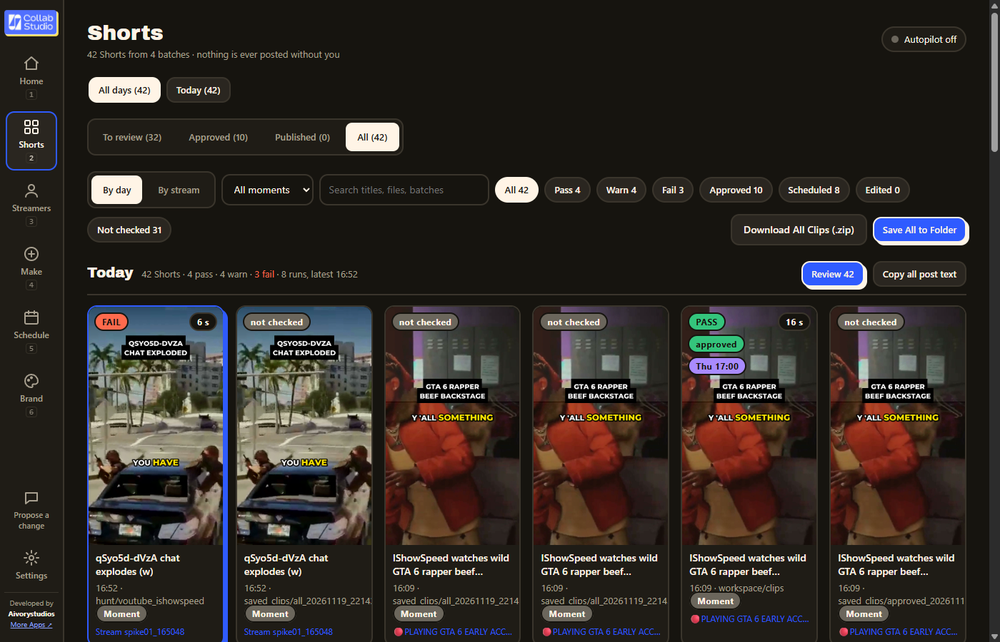
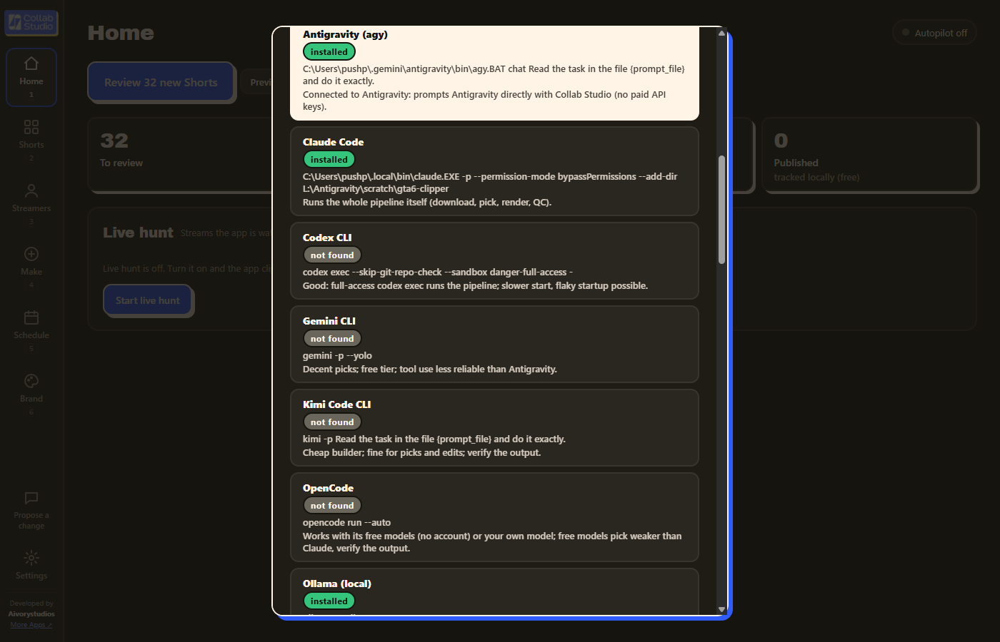

  
  <h1>Collab Studio</h1>
  
<strong>100% Free Autonomous AI Clipping, 4K/60fps Vertical Video Rendering & Scheduling Studio</strong>

  

    <em>Developed by <a href="https://aivorygen.vercel.app">Aivorystudios</a></em>
  

  [-blue.svg)](#system-requirements)
  
  
  [-purple.svg)](#antigravity-ai-linkage)
  

---

## 📌 Overview

**Collab Studio** is a complete, free, standalone desktop application that autonomously watches YouTube, Twitch, and Kick streams, discovers viral moments from audio energy and chat spikes, reframes landscape gameplay and streamer facecams into vertical 9:16 Shorts, generates word-by-word animated subtitles, and prepares free scheduled social media drops—**with zero required paid API keys**.

---

## 📸 Screenshots & Interface Tour

  <h3>1. Make Shorts & Generation Studio</h3>
  
  
<em>Create 10+ vertical 9:16 shorts from any YouTube, Twitch, or Kick URL in seconds.</em>

   

  <h3>2. Home Dashboard & Real-Time Stream Hunt</h3>
  
  
<em>Real-time streamer live detection, pending shorts review counter, and scheduler tracker.</em>

   

  <h3>3. Shorts Library & Bulk Download</h3>
  
  
<em>Instant preview, QC quality checks, "Download All Clips (.zip)", and "Save All to Folder".</em>

   

  <h3>4. Connected Antigravity AI Engine</h3>
  
  
<em>Native Google Antigravity (agy) integration detected in real time without paid API keys.</em>

---

## ⚡ Key Highlights (Point-by-Point)

- **100% Free & Unlimited**: Runs locally on your machine with zero monthly subscriptions or paid API tokens required.
- **Dedicated Desktop App (No Terminal Window)**: Launches cleanly as a windowed desktop application without any black CMD console popup.
- **Ultra-HD 4K 60fps GPU Pipeline**: Powered by NVIDIA NVENC hardware acceleration (`p5` preset, `-b:v 0`, `-cq 19`, `2160x3840`).
- **Seam-Free & Divider-Free Framing**: Smart webcam face-tracking with zero black dividing lines or artificial splitters. Full-clip blurred fill is automatically engaged when webcam is absent.
- **Multi-Source Real-Time Hunting**: Monitors 14+ top streamers on Twitch, YouTube, and Kick, auto-capturing chat volume spikes and loud gameplay peaks.
- **Word-Level Animated Subtitles**: Whisper AI generates exact timestamped captions with dynamic karaoke highlight animations, glow outlines, and display font styles.
- **Free Local Scheduling & Bulk Export**: One-click bulk download `.zip`, automated `.ics` calendar sync, and direct handoff to YouTube Studio, TikTok Studio, and Meta Business Suite.

---

## 🚀 Installation & Download

### Option 1: Windows Installer (`CollabStudio-Installer.exe`) — Recommended
1. Download **`CollabStudio-Installer.exe`** from the [Releases](#).
2. Run the installer:
   - Sets up desktop and Start Menu shortcuts with the official Collab Studio logo.
   - Automatically provisions an **isolated virtual environment (`{app}\venv`)** separate from system Python.
   - Uninstaller includes an option to preserve or wipe downloaded AI models.

### Option 2: Portable Desktop Edition (`CollabStudio-Portable-Windows-x64.zip`)
1. Download **`CollabStudio-Portable-Windows-x64.zip`**.
2. Extract to any folder.
3. Double-click **`CollabStudio.exe`** to launch immediately. No terminal prompt or installation required.

---

## 🛠️ System Compatibility & Setup Doctor (`CollabStudioSetup.exe`)

Collab Studio includes a dedicated diagnostic and setup tool: **`CollabStudioSetup.exe`**.

Launch it on first run or when re-verifying components to:
1. **Verify System Hardware**:
   - Operating System & 64-bit CPU architecture.
   - Physical Memory (RAM): Minimum 8GB recommended (16GB for native 4K rendering).
   - NVIDIA GPU & NVENC hardware encoder availability (fallback to libx264).
   - FFmpeg and ffprobe binary status.
2. **Download & Manage AI Neural Models** (with individual checkboxes and clear descriptions):
   - **OpenAI Whisper (Speech-to-Text)**: Extracts word-level timestamps for synchronized auto-captions and hook detection.
   - **YuNet Face Detector (ONNX)**: Pinpoints the streamer webcam overlay in real time so face reactions remain centered.
   - **MediaPipe Lip-Sync & Face Mesh**: Tracks mouth motion velocity to trigger automated split-screen during podcast dialogue.
   - **Meme Sound FX & Hook Pack**: Curated whooshes, risers, and stingers to increase short retention.
   - **Viral Caption Fonts Pack**: Commercial-free display fonts (The Bold Font, Komika Axis, Montserrat, Anton).
   - **yt-dlp 4K 60fps Extractor**: High-speed stream segment extractor.

---

## 🤖 Antigravity AI Linkage

Collab Studio connects directly to **Google Antigravity** via its command-line interface (`agy`):

1. **Automatic Detection**:
   Collab Studio automatically detects `agy.bat` located at `~/.gemini/antigravity/bin/agy.bat` or in your system `PATH`.
2. **Zero Paid API Keys Needed**:
   Prompts are sent directly through Antigravity CLI without requiring external billing or third-party paid keys.
3. **100% Free Heuristic Fallback**:
   If Antigravity is not detected, Collab Studio automatically switches to **No-AI Heuristic Mode**, picking clips using chat density spikes, root-mean-square loudness peaks, and video scene transitions.

---

## 🔑 YouTube Data API v3 & OAuth 2.0 Setup Guide

If you wish to enable direct YouTube channel synchronization and automated metadata publishing:

### Step 1: Create a Google Cloud Project
1. Navigate to the [Google Cloud Console](https://console.cloud.google.com/).
2. Click **Select a project** > **New Project**.
3. Name your project **`Collab Studio`** and click **Create**.

### Step 2: Enable YouTube Data API v3
1. In the left navigation menu, go to **APIs & Services** > **Library**.
2. Search for **`YouTube Data API v3`**.
3. Click on the API card and click **Enable**.

### Step 3: Configure the OAuth Consent Screen
1. Go to **APIs & Services** > **OAuth consent screen**.
2. Select User Type: **External** and click **Create**.
3. Fill in:
   - **App name**: `Collab Studio`
   - **User support email**: Your email address
   - **Developer contact email**: Your email address
4. Click **Save and Continue** through the Scopes step (no custom scopes needed).

### Step 4: Add Your YouTube Channel Email as a Test User (CRITICAL)
> **IMPORTANT**: Because your project is in testing mode, Google only permits authorized test users to authenticate.
1. In the **Test users** step (or under **Audience** > **Test users**), click **+ ADD USERS**.
2. Enter the **exact email address** associated with your YouTube channel.
3. Click **Save**.

### Step 5: Create Desktop OAuth Credentials
1. Go to **APIs & Services** > **Credentials**.
2. Click **+ CREATE CREDENTIALS** > **OAuth client ID**.
3. Set **Application type** to **Desktop App**.
4. Name it `Collab Studio Desktop Client` and click **Create**.
5. Click **Download JSON** and save the file as `client_secret.json`.

### Step 6: Connect in Collab Studio Setup
1. Launch **`CollabStudioSetup.exe`**.
2. Open the **YouTube Data API v3** tab.
3. Click **Browse...** and select your downloaded `client_secret.json`.
4. Click **Authorize & Connect Channel**.
5. Your browser will open asking you to select your Google Account and grant permissions. Once verified, your channel name and avatar will be connected!

*(Note: If you do not configure Google Cloud API, Collab Studio's Free Local Schedulers and one-click bulk export work 100% offline with zero setup).*

---

## 📋 Free Local Schedulers

Collab Studio provides zero-friction handoff to free native platform schedulers without requiring paid third-party posting APIs:

| Platform | Free Scheduler URL | Method |
| :--- | :--- | :--- |
| **YouTube Shorts** | [YouTube Studio](https://studio.youtube.com/) | Drag up to 15 MP4s at once &gt; Set Visibility to **Schedule** |
| **TikTok** | [TikTok Studio](https://www.tiktok.com/tiktokstudio/upload) | Upload MP4 &gt; Enable **Schedule video** toggle |
| **Instagram / FB** | [Meta Business Suite](https://business.facebook.com/latest/composer) | Create Reel &gt; Select **Scheduling options** |
| **X / Twitter** | [X Compose](https://x.com/compose/post) | Attach video &gt; Click the **Calendar icon** |

Export all metadata at once with the **`POSTING_PLAN.txt`** and **`schedule.ics`** calendar files included in the bulk `.zip` download.

---

## 💻 Tech Stack & Architecture

- **Backend**: Python 3.13 standard library (`http.server`, `subprocess`, `threading`, `json`).
- **Frontend**: Zero-dependency single-file reactive HTML/CSS/JS (`app.html`) with CSS design system tokens.
- **Video Engine**: FFmpeg with NVIDIA NVENC (`h264_nvenc`) GPU hardware acceleration + OpenCV.
- **Vision Models**: YuNet face detection ONNX + MediaPipe Face Mesh.
- **Audio Models**: OpenAI Whisper (transcription & word alignment).
- **Desktop Wrapper**: Microsoft Edge / Chrome application window launcher (`--noconsole`).
- **Installer**: Inno Setup 6 with custom Pascal uninstallation routines.

---

## 📄 License & Attribution

- **License**: MIT License — 100% Free and Open Source.
- **Developer**: Developed by **Aivorystudios** ([https://aivorygen.vercel.app](https://aivorygen.vercel.app)).
- **Repository**: [https://github.com/pushpajit-dev/collab-studio](https://github.com/pushpajit-dev/collab-studio)
